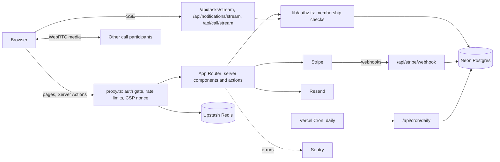

# Tide

Project management for small teams, built on the Next.js 16 App Router: workspaces, kanban boards, tasks, comments, live updates and calls, with role-based access and Stripe billing.

**Live:** https://next-project-management-three.vercel.app/


---

## Features

- **Workspaces**: separate spaces for teams or clients, each with its own projects, members and roles (owner, admin, member).
- **Invites by email**: token links that work for people without an account; ownership transfer, leaving and removal.
- **Boards**: kanban, list and table views; custom columns; drag and drop with mouse, touch and keyboard; filters and sorting.
- **Tasks**: assignees, priority, due dates, descriptions, a detail sheet with deep links, bulk actions.
- **Comments** with `@mentions`, and an **activity log** per workspace.
- **Live updates**: boards, lists and notifications follow other people's changes within seconds (Server-Sent Events).
- **Calls (beta)**: per-project video calls for up to 4 people, peer to peer over WebRTC, with TURN relay for strict networks.
- **Notifications**: in-app, plus email for assignments, mentions, due-soon reminders and an optional daily digest, each switchable.
- **Accounts**: email/password and Google sign-in, email verification, password reset, account deletion.
- **Search**: a ⌘K command palette across tasks, projects and comments.
- **Billing**: Free, Pro and Business plans through Stripe.
- **Accessible and mobile-friendly**: axe-checked pages, screen-reader drag announcements, phone layouts, dark mode.

---

## Tech stack

| Layer | Choice |
|---|---|
| Framework | Next.js 16 (App Router, Server Actions, `proxy.ts`), React 19 |
| Database | PostgreSQL on [Neon](https://neon.tech), Drizzle ORM (neon-http driver) |
| Auth | Better Auth (email/password, Google OAuth) |
| Payments | Stripe (Checkout, Billing Portal, webhooks) |
| Email | Resend with React Email templates |
| Rate limiting | Upstash Redis |
| Calls | simple-peer (WebRTC), Cloudflare TURN |
| UI | Radix UI, Tailwind CSS v4, @dnd-kit, cmdk |
| Forms and validation | React Hook Form, Zod |
| Monitoring | Sentry (errors, replays, CSP reports, uptime), Vercel Speed Insights |
| Testing | Vitest, Playwright, axe-core |
| Hosting | Vercel (functions, cron), GitHub Actions CI |

---

## Architecture



```
app/                     Pages and route handlers
  (marketing)/           Public landing, pricing, privacy, terms (static)
  (auth)/                Log in, register, password reset, email verification
  (dashboard)/           The app: workspaces, projects, settings, notifications
  (invite)/              Invite links and pending invites
  api/                   Streams, calls, Stripe webhook, cron, health
features/<name>/         One module per feature: actions.ts, schema.ts, components/, hooks/
lib/                     Shared server code: authz, auth, env, csp, sse, email, jobs, rate limits
db/schema.ts             Drizzle schema
db/migrations/           Migration history (the source of truth for the database)
e2e/                     Playwright specs
tests/                   Vitest unit tests, mirroring features/ and lib/
docs/                    Production plan and runbooks
proxy.ts                 Runs before every page: session gate, rate limits, CSP
```

**Key decisions**
- **Server Actions for writes.** Every mutation is a typed server function that checks access and validates input with Zod before touching the database. Plan limits are enforced there too, not only in the UI.
- **Feature modules.** Each feature keeps its actions, schemas, components and hooks together.
- **Atomic writes without interactive transactions.** The neon-http driver has none, so rows that must change together go through `db.batch()`, which runs as one transaction. Races are handled with row locks and guarded statements inside the batch.
- **Live updates by polling, not pub/sub.** Each stream checks a content snapshot of the project every few seconds and asks the page to refresh when it changes. Streams close themselves before Vercel's 300-second function limit, and the browser reconnects without missing changes (`lib/sse.ts`).

---

## Security Model

Tide is multi-tenant: every project, task, comment and activity entry belongs to exactly one workspace, and users may only touch workspaces they are members of.

**Every server entry point that takes an ID goes through [`lib/authz.ts`](lib/authz.ts).**

| Helper | Resolves | Used by |
|---|---|---|
| `requireSession()` | the signed-in user | `/api/call/leave` |
| `requireWorkspaceMember(workspaceId, { roles? })` | workspace + caller's role | activity feed |
| `requireProjectAccess(projectId, { roles? })` | project → workspace → membership | task creation, bulk actions, reorder, call and board streams |
| `requireTaskAccess(taskId, { roles? })` | task → project → workspace → membership | single-task updates, comments, task activity |
| `requireCommentAccess(commentId)` | comment → task → project → membership | comment edit and delete |

The rules these helpers enforce:

- **One query, through membership.** Each helper joins from the resource to the caller's `member` row in a single query, so there is no gap between "does it exist?" and "may I see it?".
- **Not found, never forbidden.** A resource in someone else's workspace is indistinguishable from one that doesn't exist (`{ error: 'Not found.' }` from actions, `404` from routes and pages). This stops other tenants' IDs being probed.
- **Never trust client context.** Client-supplied relations are re-checked on the server. Target columns must belong to the task's project, assignees and @mentions are resolved against the workspace's real members, and bulk operations are rejected outright if any ID falls outside the project.
- **Validate first.** Every Server Action and Route Handler parses its input with Zod before touching the database.
- **Pages too.** The workspace layout and project page call `notFound()` for non-members, and the sidebar's project list is fetched through the caller's membership.
- **Atomic multi-row writes.** Rows that must exist together (a workspace and its owner; a project, its columns and its first task) are written with `db.batch()`, which runs as a single transaction on Neon.

Workspace management actions (`features/workspaces/actions.ts`) additionally enforce roles: only owners and admins can invite, change roles or remove members, and only owners can delete a workspace. Cross-tenant tests live in `tests/lib/authz.test.ts`, `tests/features/**/actions.test.ts`, `tests/api/` and `e2e/tenant-isolation.spec.ts`.

### Beyond tenant isolation

- **Rate limits** (`lib/rate-limit.ts`, `proxy.ts`): credential and email endpoints under `/api/auth` per IP; invites, comments, task creation, assignee changes and account deletion per user. Counted in Upstash Redis, so the limits hold across serverless instances.
- **Invites** (`lib/invite-token.ts`): single-use tokens, stored hashed, that expire. An unverified account can't claim an invite by email address alone.
- **Content Security Policy** (`lib/csp.ts`, `proxy.ts`): no `eval`, no plugins, no framing by other sites. Dynamic pages get a fresh nonce per request, so only scripts Next marked can run inline; a stricter `'strict-dynamic'` policy runs Report-Only alongside it, with reports in Sentry.
- **Environment checks** (`lib/env.ts`): a production build or server refuses to start with a missing or malformed secret.
- **Privacy in monitoring**: Sentry events identify users by ID only, never email; cookies, headers and IP addresses aren't sent; session replays mask all text and inputs.

---

## Local setup

### Prerequisites

- **Node.js 24** (`.nvmrc`; run `nvm use`). Older npm versions reject the lockfile.
- A Postgres database. Use a **Neon dev branch**, never production: the E2E tests write data, and refuse to run against the production branch.
- For the full app: Google OAuth credentials, a Stripe test account and a Resend API key. You can start without them; see below.

### Steps

```bash
git clone https://github.com/rizkyr99/next-project-management.git
cd next-project-management
nvm use
npm ci
cp .env.example .env      # fill in at least DATABASE_URL, BETTER_AUTH_SECRET, BETTER_AUTH_URL
npm run db:migrate        # build the schema from db/migrations/
npm run dev               # http://localhost:3000
```

There's no seed script: register an account, create a workspace, and it comes with a **Getting started** project whose tasks walk you through the app.

In development, a missing or malformed variable is a warning, not an error, so you can leave out Stripe, Google or Resend until you need them. Emails to reserved test domains (`example.com` and similar) are never sent.

> **Migrations:** never run `drizzle-kit push` against a shared or production database. Change `db/schema.ts`, run `npm run db:generate`, review the SQL, commit it, then `npm run db:migrate`. See [docs/runbooks/migrations.md](docs/runbooks/migrations.md).

> **Stripe webhooks locally:** `stripe listen --forward-to localhost:3000/api/stripe/webhook`, and put the `whsec_…` it prints in `STRIPE_WEBHOOK_SECRET`.

---

## Environment variables

Validated by [`lib/env.ts`](lib/env.ts); a unit test checks that every variable it knows is documented here and in [`.env.example`](.env.example).

| Variable | Required | Description |
|---|---|---|
| `DATABASE_URL` | yes | Postgres connection string (Neon, pooled). |
| `BETTER_AUTH_SECRET` | yes | Signs sessions; 32+ characters (`openssl rand -hex 32`). Changing it signs everyone out. |
| `BETTER_AUTH_URL` | yes | Absolute base URL, e.g. `http://localhost:3000`. |
| `GOOGLE_CLIENT_ID` / `GOOGLE_CLIENT_SECRET` | yes | Google OAuth client. |
| `STRIPE_SECRET_KEY` | yes | `sk_test_…` or `sk_live_…`. |
| `STRIPE_WEBHOOK_SECRET` | yes | Webhook signing secret, `whsec_…`. |
| `STRIPE_PRO_PRICE_ID` / `STRIPE_BUSINESS_PRICE_ID` | yes | Stripe price IDs for the paid plans. |
| `RESEND_API_KEY` | yes | Resend API key, `re_…`. |
| `EMAIL_FROM` | production | Sender on a domain verified in Resend, e.g. `Tide <notifications@your-domain>`. Locally it falls back to Resend's test sender, which only reaches the Resend account owner. |
| `NEXT_PUBLIC_CONTACT_EMAIL` | production | Contact address shown on the privacy and terms pages. |
| `CRON_SECRET` | for the daily job | 16+ characters. Vercel Cron sends it to `/api/cron/daily`; without it the job refuses every call. |
| `KV_REST_API_URL` / `KV_REST_API_TOKEN` | production | Upstash Redis for rate limits (`UPSTASH_REDIS_REST_*` also work). Without them, limits fall back to per-process memory, which doesn't hold on Vercel. Not checked by `lib/env.ts`. |
| `CLOUDFLARE_TURN_KEY_ID` / `CLOUDFLARE_TURN_API_TOKEN` | no | Cloudflare TURN key for calls. Without it, calls use public STUN only. |
| `NEXT_PUBLIC_APP_URL` | no | Public base URL for links in emails. Defaults to `BETTER_AUTH_URL`. |
| `VERCEL_ENV` | set by Vercel | `production`, `preview` or `development`. Selects production-only checks and the Sentry environment. |
| `SKIP_ENV_VALIDATION` | no | `1` skips the checks, for unusual builds. |

Test and CI only: `NEXT_PUBLIC_SENTRY_DISABLED=1` keeps a production build from reporting to Sentry; `E2E_SERVER=start` makes Playwright run `next start` (a production build) instead of `next dev`.

---

## Scripts

```bash
npm run dev            # development server
npm run build          # production build
npm start              # serve the production build
npm run lint           # ESLint
npm test               # unit tests (Vitest)
npm run test:coverage  # unit tests with coverage
npm run test:e2e       # end-to-end tests (Playwright); needs a dev database
npm run db:generate    # new migration from schema.ts changes
npm run db:migrate     # apply pending migrations to DATABASE_URL
npm run db:check       # check the migration history
npm run db:studio      # browse the database
```

---

## Testing

- **Unit** (`tests/`, Vitest): actions, authorization, routes and helpers with the database and Next modules mocked; no database needed. CI fails if coverage of `features/*/actions.ts` and `lib/authz.ts` drops below 80%.
- **End-to-end** (`e2e/`, Playwright): real browsers against a real database, covering tenant isolation, invites, boards, realtime, calls (with Chromium's fake camera), accessibility (axe), mobile layouts and the CSP. They need `DATABASE_URL` to point at a **dev** branch; `e2e/helpers/db.ts` refuses the production branch.

```bash
npm test
npx playwright install chromium
npm run test:e2e
```

**CI** (GitHub Actions) runs on every pull request to `develop` and `main`: type check, lint, unit tests with the coverage gate, a production build, and a migration check (a fresh Postgres is built from `db/migrations/`, and the job fails if `schema.ts` changed without a migration). **E2E** runs on release pull requests into `main`, and on any pull request with the `e2e` label: a production build, in Playwright's container, in 3 shards, each against its own short-lived Neon branch copied from the dev branch.

---

## Deployment and operations

- **Hosting:** Vercel. `main` deploys to production; every pull request gets a preview.
- **Flow:** feature branches merge into `develop`; a release pull request from `develop` into `main` ships them (see [CONTRIBUTING.md](CONTRIBUTING.md)).
- **Migrations** are applied to production by hand before a release that needs them, after taking a Neon snapshot branch; see [docs/runbooks/migrations.md](docs/runbooks/migrations.md).
- **Daily job:** Vercel Cron calls `/api/cron/daily` at 08:00 UTC (due-soon reminders, digest, cleanup).
- **Health:** `GET /api/health` returns 200 when the database answers, 503 otherwise; a Sentry uptime monitor checks it.
- **Monitoring and runbooks:** alerts, rollback, backups, secret rotation and Stripe webhook replay are in [docs/runbooks/](docs/runbooks/README.md).

---

## Plans

| | Free | Pro | Business |
|---|---|---|---|
| Price | $0 | $9 / month | $29 / month |
| Workspaces you own | 1 | 5 | Unlimited |
| Projects, members, tasks | Unlimited | Unlimited | Unlimited |

Defined once in [`lib/plans.ts`](lib/plans.ts), which the pricing page, billing settings and server-side limit checks all read. Plan changes take effect when Stripe's webhook arrives.

---

## Further reading

- [docs/PRODUCTION_PLAN.md](docs/PRODUCTION_PLAN.md): the audit and the phased plan this codebase was hardened with, with what was done and why.
- [CASE_STUDY.md](CASE_STUDY.md): the most instructive problems along the way.
- [CHANGELOG.md](CHANGELOG.md)
